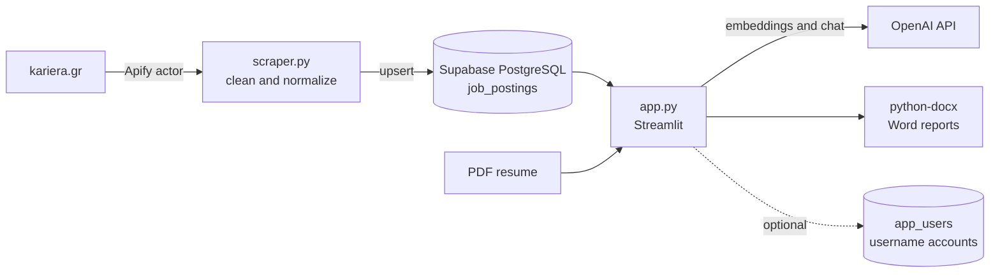

# AI Job Market Analyzer

**Live demo:** https://greek-job-market.streamlit.app/

An end-to-end AI project that analyzes the Greek job market and tells you how your CV compares to it. It collects real job postings from [kariera.gr](https://www.kariera.gr), stores them in PostgreSQL, shows which skills and industries are in demand, and lets you upload a PDF resume to get a skill-gap evaluation, the best-matching postings and a tailored cover letter.


## What it does

- **Market dashboard:** demand for 10 tracked tech skills, postings per industry, remote / hybrid / on-site split, average salary per industry (only where salaries are published) and top locations.
- **Job browser:** filter the postings by skill and open the original listing.
- **CV analysis:** upload a PDF resume and see a radar chart of your skills against market demand.
- **Semantic job matching:** your CV and every posting are turned into embeddings, and the 5 closest postings are returned with a relative match percentage.
- **AI feedback and cover letter:** GPT-4o-mini evaluates the CV and writes a cover letter (output in Greek), both downloadable as Word files.

| CV analysis | Job matches |
|---|---|
|  |  |

## Architecture



| File | Role |
|---|---|
| `scraper.py` | ETL: calls the Apify kariera.gr actor, strips HTML from descriptions, normalizes fields and upserts into Supabase. Runs locally, not in the cloud app. |
| `app.py` | The Streamlit app: dashboard, job browser, CV analysis. |
| `skills_config.py` | The tracked skills list and word-boundary matching used for demand counts and the CV radar. |
| `matching.py` | Embedding-based CV-to-job matching with an in-memory cache. |
| `docx_utils.py` | Builds the downloadable Word reports. |
| `auth.py` | Optional username and password accounts (PBKDF2 hashes in an `app_users` table). |
| `supabase_jobs.sql`, `supabase_users.sql` | Database schema. |

### How the matching works

1. The CV text (first 4,000 characters) and each posting (title plus the first 2,000 characters of the description) are embedded with `text-embedding-3-small`.
2. Posting embeddings are cached in memory, so a posting is embedded once per app process.
3. Cosine similarity is computed between the CV and every posting.
4. Raw cosine scores between a CV and a job ad rarely exceed about 0.6, even for a strong match, so showing them as a percentage would be misleading. The scores are min-max normalized across the current pool of postings, so the percentage means "how much closer than the other available postings", not an absolute grade. The app says so next to the results.

## Tech stack

Python, Streamlit, Plotly, Supabase (PostgreSQL), OpenAI API (`gpt-4o-mini`, `text-embedding-3-small`), Apify, PyPDF2, python-docx.

## Run it locally

You need a Supabase project, an OpenAI API key and (to collect data) an Apify token.

```bash
git clone https://github.com/GEODPL/job-market-analyzer.git
cd job-market-analyzer
python -m venv .venv
# Windows: .venv\Scripts\activate    macOS/Linux: source .venv/bin/activate
pip install -r requirements.txt
```

1. **Create the tables.** In the Supabase SQL Editor run `supabase_jobs.sql` (and `supabase_users.sql` if you want accounts).
2. **Configure the app.** Copy `.streamlit/secrets.toml.example` to `.streamlit/secrets.toml` and fill in `SUPABASE_URL`, `SUPABASE_KEY` (publishable key), `OPENAI_API_KEY`.
3. **Collect data.** Create a `.env` file for the scraper:
   ```
   SUPABASE_URL=https://xxxx.supabase.co
   SUPABASE_KEY=<secret / service_role key>
   APIFY_API_TOKEN=<your Apify token>
   ```
   then run `python scraper.py`. It replaces the contents of `job_postings` with up to 150 fresh postings.
4. **Start the app.**
   ```bash
   streamlit run app.py
   ```

`.env` and `.streamlit/secrets.toml` are git-ignored. Never commit keys.

### Deploy to Streamlit Community Cloud

Push the repo to GitHub, create an app at [share.streamlit.io](https://share.streamlit.io) pointing at `app.py`, choose Python 3.12 under Advanced settings and paste the contents of your `secrets.toml` into the Secrets box.

## Limitations

- The tracked skills are a fixed list of 10 (`skills_config.py`) matched by keyword, so synonyms and spelling variants are missed.
- Data comes from a third-party scraper (Apify actor) and one source, so coverage depends on kariera.gr and on the actor keeping its output format.
- `scraper.py` replaces the whole table on every run instead of merging, which keeps the data fresh but drops postings that are no longer listed.
- The embedding cache lives in memory and resets when the app restarts.
- Salary statistics only use postings that publish a salary range.

## What I learned

- **Matching ranked by raw similarity is misleading.** Cosine scores between a CV and a job ad cluster in a narrow low range. Normalizing within the pool made the percentage readable, and I learned to state clearly what a score means.
- **Keys and permissions are part of the design.** I moved all credentials to environment variables and Streamlit secrets, kept them out of Git, and separated the publishable key (read-only, subject to row-level security) from the secret key that bypasses it.
- **Deployment constraints shape the architecture.** I first built a FastAPI backend with a JavaScript frontend, then rebuilt it as a single Streamlit app because Streamlit Community Cloud only runs Streamlit apps.
- **Free tiers go to sleep.** A paused Supabase project made the app fail with a DNS error until I restored it, which taught me to read the error rather than guess.
- **Third-party data needs defensive code.** The scraper's output field names are not guaranteed, so `scraper.py` tries several names per field and tolerates missing values.
- **Usability evidence beats opinion.** The same habit comes from my thesis project, [Project Wellness](https://project-wellness.streamlit.app/), where a usability study with 15 users (SUS) guided the improvements.
